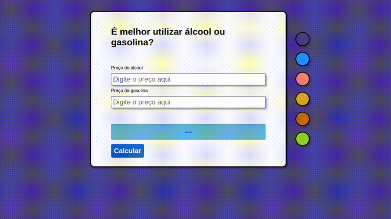

# Projeto "Álcool ou Gasolina"

# Sobre

Aplicativo simples que compara o número digitado no campo de álcool e no campo de gasolina. Ao clicar no botão "_CALCULAR_",
**o programa indica na caixa azul qual opção é mais barata** (qual número é menor). O aplicativo também possui uma série de botões para alterar a cor do fundo.

# Objetivos
* Compreender como o Javascript é aplicado em uma estrutura HTML;
* Trabalhar os conceitos básicos da linguagem **Javascript**;
* Aprimorar habilidades em **CSS Flexbox**.

# Tecnologias colocadas em prática
* HTML
* CSS
  * CSS Flexbox
* Javascript
  * Fundamentos (_lógica de programação, estruturas condicionais, funções_)
  * Eventos
